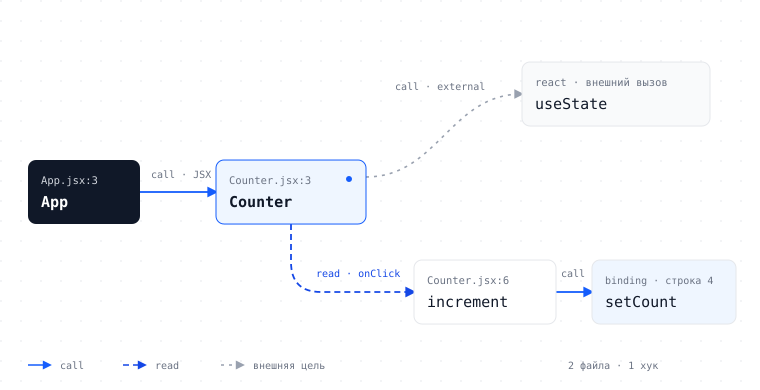
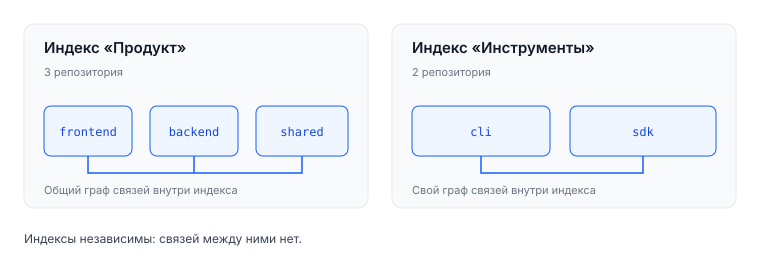

# SymbolTrail: граф кода для ИИ-агентов

**SymbolTrail** — это локальный инструмент, который превращает JavaScript- и TypeScript-проекты в подробную карту (граф знаний). Он связывает функции, типы и зависимости воедино, причем работает это даже в рамках множества репозиториев.

Через протокол **MCP** (Model Context Protocol) ИИ-агент получает идеальный контекст для любой задачи: находит нужную реализацию, прослеживает цепочки вызовов и точно оценивает, какие части проекта затронет ваша правка.

Всё работает локально, данные не уходят на сторону. При этом вы можете исследовать тот же граф вручную через [CLI](/tools) или [веб-интерфейс](/local-ui).

> 🏆 **Результативность.** SymbolTrail и Graphify получили по **10 из 10** за полноту ответов в сравнении на десяти задачах. Для SymbolTrail в сводку вошли два контрольных повтора. [Результаты сравнения](/benchmarks/investigations)

<section class="st-home-features" aria-label="Преимущества SymbolTrail">
  <article class="st-home-feature">
    
      <svg viewBox="0 0 24 24" fill="none" stroke="currentColor" stroke-width="1.6" stroke-linecap="round" stroke-linejoin="round" focusable="false">
        <rect x="3" y="3" width="6" height="6" rx="1.5" />
        <rect x="15" y="3" width="6" height="6" rx="1.5" />
        <rect x="9" y="15" width="6" height="6" rx="1.5" />
        <path d="M6 9v3h12V9M12 12v3" />
      </svg>
    
    <h2>Кроссрепо</h2>
    
Фронтенд, бэкенд и общие библиотеки в одном индексе. Агент видит связи и потребителей кода за границами отдельного репозитория.

  </article>
  <article class="st-home-feature">
    
      <svg viewBox="0 0 24 24" fill="none" stroke="currentColor" stroke-width="1.6" stroke-linecap="round" stroke-linejoin="round" focusable="false">
        <path d="M20 7v5h-5M4 17v-5h5" />
        <path d="M6.1 7a7 7 0 0 1 11.6-1L20 9M4 15l2.3 3A7 7 0 0 0 17.9 17" />
      </svg>
    
    <h2>Быстрое обновление</h2>
    
Инкрементальная сборка использует хеши и кэш, чтобы обновлять изменившиеся части. Режим <b>watch</b> поддерживает граф актуальным, пока вы работаете с кодом.

  </article>
  <article class="st-home-feature">
    
      <svg viewBox="0 0 24 24" fill="none" stroke="currentColor" stroke-width="1.6" stroke-linecap="round" stroke-linejoin="round" focusable="false">
        <circle cx="12" cy="12" r="8" />
        <path d="m8.5 12 2.5 2.5 4.5-5" />
      </svg>
    
    <h2>Высокая точность индекса</h2>
    
Связывает любые вызовы с определениями и различает одноимённые символы в разных файлах и репозиториях.

  </article>
  <article class="st-home-feature st-home-feature-tokens">
    
      <svg viewBox="0 0 24 24" fill="none" stroke="currentColor" stroke-width="1.6" stroke-linecap="round" stroke-linejoin="round" focusable="false">
        <path d="m4 6 8-4 8 4-8 4-8-4ZM4 12l8 4 8-4M4 18l8 4 8-4" />
      </svg>
    
    <h2>На 30% меньше токенов</h2>
    
Экономия по сравнению с работой без MCP. Компактные карточки связей и фрагменты исходников оставляют больше контекста для самой задачи.

  </article>
</section>

### Как это работает на практике? (На примере React)

<figure class="st-figure">
  
  <figcaption>Основные связи двух файлов, проверенные через индекс SymbolTrail</figcaption>
</figure>

Код React-примера

В примере простой счётчик из двух файлов с одним хуком `useState`. Эти файлы прошли индексацию; из них же загружается код во вкладках.

::: code-group

<<< @/../examples/react-counter/App.jsx [App.jsx]

<<< @/../examples/react-counter/Counter.jsx [Counter.jsx]

:::

Основные связи, которые записал индекс:

- `App → Counter`: `call` из JSX. Карточка помечает разрешение импорта как `likely imported`.
- `Counter → useState`: записанный внешний вызов. Реализация React в этот пример не индексировалась.
- `Counter → increment`: `read` в атрибуте `onClick`. Индекс фиксирует чтение обработчика, а не его вызов.
- `increment → setCount`: вызов через привязку переменной на строке 4. Привязка не раскрывает тело реализации React.

Обычные чтения `count` на схеме опущены. Схема показывает основные связи, а не полный граф всех фактов.

Представьте простой счетчик на React из двух файлов. Когда SymbolTrail индексирует их, он видит не просто текст, а логику:

- **`App → Counter`**: Понимает, что `App` вызывает `Counter` через JSX (и помечает, что компонент импортирован).
- **`Counter → useState`**: Фиксирует внешний вызов хука.
- **`Counter → increment`**: Видит, что функция `increment` передается в атрибут `onClick`. Инструмент умно определяет это как _чтение_ (передачу) обработчика, а не его прямой вызов.
- **`increment → setCount`**: Отслеживает вызов через привязку переменной.

### Три кита SymbolTrail

#### 1. Вершины (Узлы графа)

Любая функция, класс, метод, переменная или тип (интерфейс) — это объявление. У каждого есть точный «адрес» в коде. Если в проекте есть две функции `foo` (в разных файлах или репозиториях), инструмент никогда их не перепутает, так как учитывает имя репозитория, файл и позицию.

#### 2. Связи (Ребра графа)

Символы в коде живут не изолированно. SymbolTrail различает:

- **Импорты и реэкспорты** (связи между файлами).
- **Вызовы** (от места `foo()` до конкретной реализации).
- **Ссылки и типы** (использование значений или типовых контрактов).
- **Привязки** (переменные или параметры, через которые идет вызов).

_Инструмент умеет разрешать конфликты имен: если функций с одинаковым именем несколько (или они в одной строке), он анализирует контекст использования, чтобы связать вызов с правильным объявлением._

#### 3. Индекс (База знаний)

Индекс объединяет один или несколько репозиториев (например, микро-фронтенды, монорепо и общие библиотеки). Связи строятся как внутри них, так и между ними.

- Вы можете создать отдельные индексы для основного продукта и внутренних утилит. Они полностью независимы и хранятся в локальных **SQLite** базах.
- После изменения кода индекс обновляется одной командой ([`filegraph`](/indexing#разовая-сборка)) или работает в режиме реального времени ([`filegraph:watch`](/indexing#автоматическое-обновление)).

<figure class="st-figure">
  
</figure>

### Что это дает команде? (Сценарии использования)

> 💡 SymbolTrail берет на себя рутину по анализу кода, позволяя ИИ-агенту решать сложные задачи:

- **Онбординг** — быстро разобраться в незнакомом проекте и выстроить оптимальный порядок чтения файлов.
- **Объяснение кода** — проследить цепочки вызовов, потоки данных и логику обработки ошибок.
- **Ревью** — проверять диффы с учётом всех внешних потребителей изменённых объявлений.
- **Импакт-анализ и blast radius** — оценить область возможных последствий правки, включая другие репозитории индекса.
- **Диагностика ошибок** — восстановить путь данных и подготовить сценарий воспроизведения сбоя.
- **Технические задачи** — собрать контекст, определить область изменений и сформулировать критерии приёмки.
- **Спецификации** — описать контракты, поведение при ошибках, совместимость и пограничные случаи.
- **Тесты** — найти релевантные тестовые места, подобрать проверки и спланировать регрессии.
- **Рефакторинг** — проверить всех потребителей, найти похожие решения и безопасно спланировать изменения.
- **Неиспользуемый код** — найти кандидатов на удаление и проверить, что их действительно можно убрать.
- **Зависимости и циклы** — изучить связи между модулями, файлами и целыми репозиториями.
- **История изменений** — найти авторов и коммиты, которые формировали текущий код.

💡 **Важно:** задачи, спецификации и тесты готовит ИИ-агент на основе графа и актуальных исходников. Примеры запросов и ожидаемые результаты собраны на странице [«Сценарии использования»](/use-cases).

### С чего начать?

На данный момент языковой пакет поддерживает **JavaScript, JSX, TypeScript и TSX**.

Готовы попробовать? Переходите к следующим шагам:

1.  **[Быстрый старт](/getting-started)** — соберите свой первый индекс и выполните запрос.
2.  **[Сценарии использования](/use-cases)** — посмотрите примеры промптов для ИИ-агента.
3.  **[Подключение MCP](/mcp)** — интегрируйте SymbolTrail в ваш редактор или клиент для ИИ-агентов.
4.  **[Индексация](/indexing)** — узнайте, как настроить работу с монорепозиториями и несколькими корнями.
