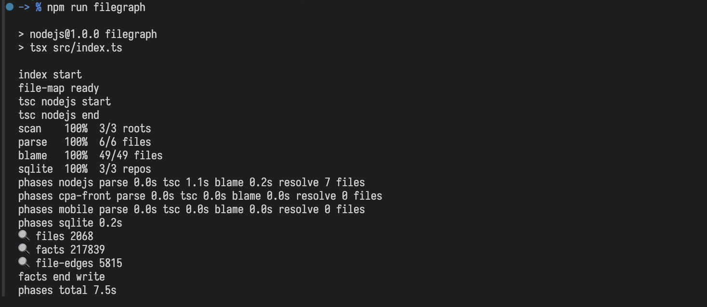

# Индексация

<p class="st-lead">Создайте снимок проекта и поддерживайте его актуальным.</p>

## Разовая сборка

Запустите индексацию из корня репозитория SymbolTrail:

```sh
npm run filegraph
```

<figure class="st-figure">
  
</figure>

**Что происходит:**
Индексатор сканирует файлы, импорты, объявления и места использования. Он разрешает цели связей (кто кого вызывает) и записывает результат в базу **SQLite**.

- **Инкрементальность:** Повторные сборки используют хеши и кэш, чтобы обновлять только измененные части.
- **Git-интеграция:** Если проект под Git, индексатор учитывает `.gitignore`. Файлы, которые уже отслеживаются Git, остаются в индексе, даже если попадают под правила игнорирования. Без Git просто обходит весь каталог.

---

## Автоматическое обновление (Watch)

Для постоянной синхронизации запустите режим наблюдения:

```sh
npm run filegraph:watch
```

1.  Сначала строится полный индекс.
2.  Затем система следит за изменениями в исходниках и настройках путей.
3.  При серии изменений ждет ~3 секунды и запускает последовательное обновление.

> 💡 **MCP и Watch:** Работающий MCP-сервер автоматически подхватывает новую версию индекса без перезапуска. Во время пересборки запросы продолжают читать уже записанные (стабильные) данные.

## Переменные окружения

Переменные задаются перед командой запуска. Примеры ниже используют синтаксис macOS/Linux; значения действуют только для указанной команды.

### Параллелизм

Основной конвейер выполняет стадии последовательно: разбор файлов → Git blame (с флагом `--blame`) → разрешение связей TypeScript → запись SQLite. Внутри вычислительных стадий используются отдельные очереди и исполнители.

- **`FILEGRAPH_JOBS`** — общий ориентир параллелизма. По умолчанию равен доступному параллелизму CPU (`os.availableParallelism()`), минимум 1. Парсер использует потоки, TypeScript — отдельные процессы. Явное значение может превышать число доступных CPU.
- **`FILEGRAPH_TSC_JOBS`** — верхняя граница числа процессов разрешения TypeScript. По умолчанию берётся `FILEGRAPH_JOBS`; значение ограничивается им сверху. Фактическое число процессов зависит от количества заданий и режима очереди.
- **`FILEGRAPH_GIT_JOBS`** — отдельный лимит одновременно выполняемых асинхронных Git-команд. По умолчанию берётся `FILEGRAPH_JOBS`, но явно заданное значение им не ограничивается. Основная очередь запускает `git blame` по файлам и затем загружает сведения о коммитах; служебные команды Git могут выполняться вне этой очереди.
- **`FILEGRAPH_TSC_SCHEDULE`** — режим очереди TypeScript: `affinity` (по умолчанию) или `files`. В `affinity` ограничивается число копий TS-контекста каждого корня; в `files` задания распределяются общей файловой очередью без этого ограничения на корень.
- **`FILEGRAPH_TSC_FILES_PER_SESSION`** — положительное целое число, по умолчанию `1024`. В режиме `affinity` задаёт ориентир нагрузки на одну TS-сессию: предел числа сессий одного корня вычисляется как `ceil(количество заданий / значение)`, с учётом общего лимита TS-процессов. Это не размер фиксированного пакета файлов. Меньшее значение допускает больше сессий на один корень; в режиме `files` на число процессов не влияет.

Пример: до восьми потоков парсера, до четырёх TS-процессов и до четырёх Git-команд:

```sh
FILEGRAPH_JOBS=8 \
FILEGRAPH_TSC_JOBS=4 \
FILEGRAPH_GIT_JOBS=4 \
npm run filegraph -- --blame
```

Лимиты задают число параллельных исполнителей, а не закрепляют их за конкретными ядрами. Полная загрузка CPU зависит от количества заданий, диска и доступной памяти. Дополнительные TS-сессии увеличивают расход памяти; автоматического ограничения по RAM нет. Go-часть TS-воркеров получает `GOMAXPROCS=1` независимо от значения в окружении запуска.

Запись SQLite выполняется синхронно, через одно соединение и по одному репозиторию за раз. `FILEGRAPH_JOBS` не распараллеливает эту стадию.

### Диагностика

- **`FILEGRAPH_PROFILE=1`** — включает подробные замеры стадий и исполнителей: парсера, Git, TypeScript и публикации SQLite. По умолчанию профилирование выключено.
- **`FILEGRAPH_LOG=json`** — выводит события журнала в формате JSON вместо обычного текста. Отдельные диагностические сообщения и профили могут сохранять собственный формат; это не режим JSON для всего stdout.

Например, чтобы сравнить длительность стадий при выбранных лимитах:

```sh
FILEGRAPH_JOBS=8 \
FILEGRAPH_TSC_JOBS=4 \
FILEGRAPH_GIT_JOBS=4 \
FILEGRAPH_PROFILE=1 \
npm run filegraph -- --blame
```

### Выбор исходников

`FILEGRAPH_SET`, `FILEGRAPH_REPO` и `FILEGRAPH_ROOTS` выбирают индекс или его корни. `FILEGRAPH_ROOT` задаёт один корень для запуска без каталога индексов; по умолчанию используется текущая папка. Форматы и приоритеты описаны в разделе [«Способы выбора индекса»](#способы-выбора-индекса).

`--blame` и `--vectors` включаются флагами после `--` в команде npm, переменных окружения для них нет. Флаг `--vectors` описан в разделе [о семантическом поиске](#векторы-для-семантического-поиска).

---

## Несколько корней (Monorepo)

Вы можете объединить несколько проектов в один индекс одним запуском:

```sh
npm run filegraph -- /path/to/project-a /path/to/project-b
```

- Проекты попадут в один общий индекс.
- Имя индекса формируется по первому пути.
- Имена участников (репозиториев) определяются автоматически. Они должны быть уникальными.

Для тонкой настройки (`alias`, `sourceRoot`, `exposes`) лучше сохранить конфигурацию в файле `.SymbolTrail/index-roots.json` и запускать сборку без явных путей.

> 💡 В параметре `repo` при запросах нужно указывать именно **имя участника** (из конфига), а не путь на диске или имя базы данных.

---

## Выбор индекса

Файл `.SymbolTrail/index-roots.json` управляет списками репозиториев. Он хранит массив `db` (список индексов) и поле `active` (индекс по умолчанию).

Пример конфигурации:

```json
{
  "active": "frontend",
  "db": [
    {
      "root": "frontend",
      "roots": [
        {
          "name": "frontend",
          "path": "/path/to/frontend",
          "alias": "app",
          "sourceRoot": "src",
          "exposes": {
            ".": "./src/index",
            "./C": "./src/components/C",
            "./foo": "./src/hooks/foo"
          }
        },
        {
          "name": "backend",
          "path": "/path/to/backend",
          "alias": "core",
          "sourceRoot": "src"
        },
        {
          "name": "shared",
          "path": "/path/to/shared",
          "alias": "ui-kit",
          "sourceRoot": "src"
        }
      ]
    },
    {
      "root": "cli",
      "roots": [
        {
          "name": "cli",
          "path": "/path/to/cli"
        },
        {
          "name": "sdk",
          "path": "/path/to/sdk"
        }
      ]
    }
  ]
}
```

В этом примере:

- Индекс **`frontend`** объединяет три репозитория (фронтенд, бэкенд и общую библиотеку).
- У микрофронта `frontend` вручную задана карта `exposes`: импорты `app`, `app/C` и `app/foo` ведут в указанные исходники.
- Индекс **`cli`** содержит инструменты и SDK, анализируется отдельно.

### Способы выбора индекса

1.  **Явные пути в команде:** `npm run filegraph -- /path` (игнорирует конфиг).
2.  **Переменная `FILEGRAPH_ROOTS`:** Список путей через разделитель ОС (`:` для macOS/Linux, `;` для Windows).
3.  **Переменная `FILEGRAPH_REPO`:** Выбирает существующий набор по имени индекса или участника.
4.  **Переменная `FILEGRAPH_SET`:** Выбирает индекс для сборки (без явных корней) и для чтения через MCP/CLI.
5.  **Поле `active`:** Используется по умолчанию, если каталог индекса существует.

Если каталог индексов отсутствует, `FILEGRAPH_ROOT` задаёт один путь к проекту. Без этой переменной используется текущая папка. Относительные пути считаются от рабочей папки; явные аргументы-пути и `FILEGRAPH_ROOTS` имеют приоритет.

```sh
FILEGRAPH_ROOTS="/path/to/project-a:/path/to/project-b" npm run filegraph
```

**Пример использования (macOS/Linux):**

```sh
FILEGRAPH_SET=cli npm run mcp:cli -- 'cycles({ queries: [{}] })'
```

Здесь принудительно выбирается индекс `cli`.

---

## Поля репозитория в `roots`

Каждый элемент в массиве `roots` настраивает поведение индексатора для конкретного репозитория:

| Поле         | Описание                                                                                                                                                                       |
| :----------- | :----------------------------------------------------------------------------------------------------------------------------------------------------------------------------- |
| `path`       | Абсолютный путь к каталогу репозитория на диске. Пути в индексе будут относительными к нему (напр., `src/foo.ts`).                                                             |
| `name`       | Уникальное имя участника индекса. Используется в параметре `repo` для MCP и в полях `origin.repo`. Если не задано, берется имя папки из `path`.                                |
| `alias`      | Префикс импорта. Например, библиотека с `name: "shared"` может быть доступна как `ui-kit`. Заменяет автоматические префиксы (имя пакета, Microfrontend name).                  |
| `sourceRoot` | Папка с исходниками относительно `path` (необязательно). Позволяет мапить импорт `ui-kit/foo` в файл `src/foo.ts`. Если модуль не найден тут, поиск идет от корня репозитория. |
| `exposes`    | Ручная карта публичных модулей микрофронта: ключ — путь импорта без префикса, значение — путь к исходнику относительно `path`. Заменяет автоматическую карту из Rspack. |

> 💡 **Важно:** `alias` меняет способ импорта, но не меняет внутреннее `name`. Для вызова функции из библиотеки `ui-kit` (где `name: "shared"`), поле `origin.repo` будет равно `shared`.

---

## Микрофронты и `exposes`

Если публичные пути повторяют структуру папок, достаточно `alias` и `sourceRoot`. Для сложных маппингов укажите `exposes` прямо у репозитория в `.SymbolTrail/index-roots.json`, как в примере выше.

- Ключ `.` задает импорт самого префикса (`app` в примере), ключ `./C` — импорт `app/C`.
- Значения считаются от `path`; `sourceRoot` к ним не добавляется.
- При заданном `exposes` конфиг Rspack не читается: ручная карта полностью заменяет автоматическую.
- Пустой объект `"exposes": {}` тоже отключает автоматический поиск в Rspack. Разрешение через `package.json.exports`, `sourceRoot` и корень репозитория продолжает работать.

Если поле `exposes` отсутствует, индексатор ищет карту в конфиге Rspack. Пример (`rspack.config.*`):

```js
const federation = {
  name: "core",
  exposes: {
    "./C": "./src/components/C",
    "./foo": "./src/hooks/foo",
  },
};
```

- Импорт `core/C` приведет к `src/components/C`.
- Импорт `core/foo` приведет к `src/hooks/foo`.
- Ключи `C` и `./C` распознаются одинаково.
- `sourceRoot` к путям из `exposes` **не добавляется**.

> **Как ищется конфиг:**
> Индексатор ищет файлы `rspack.dev.*` или `rspack.config.*` в корне репозитория, а также в папках `config/` и `configs/`. Поддерживаются расширения `.ts`, `.js`, `.mts`, `.mjs`, `.cts`, `.cjs`. Берется первый найденный конфиг.

## Приоритет разрешения путей

Когда индексатор встречает импорт, он проверяет цели в следующем порядке:

1.  **TSConfig Paths:** Проверяет `paths` из `tsconfig`/`jsconfig` проекта-потребителя.
2.  **Alias:** Выбирает корень по явному `alias` или автоматическому префиксу.
3.  **Внутри выбранного корня приоритет такой:**
    - Точное совпадение ключа в `exposes` (ручной карте или конфиге Rspack).
    - Поле `exports` из `package.json` (если импорт по имени пакета).
    - Путь под `sourceRoot` (если задан).
    - Путь от корня `path`.

> Если ключ `exposes` найден, но файл отсутствует, импорт остается неразрешенным (переключения на `sourceRoot` не происходит). Значение `null` в `package.json.exports` также останавливает поиск.

## Проверка настройки

После правки JSON-конфига выполните сборку:

```sh
npm run filegraph
```

**Как проверить, что всё работает:**

1.  Найдите в коде потребителя вызов функции (например, `foo()`).
2.  Через MCP или локальный интерфейс проверьте цель этого вызова.
3.  У связанного использования должны быть заполнены: имя репозитория цели, файл объявления и ID символа.

Watch-режим автоматически пересчитывает связи при изменении `alias`, `sourceRoot`, `exposes` в каталоге индекса, конфигов Rspack или путей пакетов.

---

## Векторы для семантического поиска

Обычная сборка создает только структурный индекс. Для поиска по смыслу (semantic search) нужны векторы.

Добавьте флаг `--vectors`:

```sh
npm run filegraph -- --vectors
```

- После структуры модель `Xenova/bge-base-en-v1.5` вычислит векторы для чанков кода.
- При первом запуске модель скачается автоматически.
- Требуется опциональная зависимость `sqlite-vec`.
- Повторный запуск с флагом пересчитает все векторы заново.

Для обычного поиска по именам и навигации векторы не требуются.

---

## Что индекс не гарантирует

- **Полный ход выполнения:** Индекс показывает статические связи, полный data-flow индекс не содержит.
- **Типовые контракты:** Связь с интерфейсом или callback-параметром не всегда указывает на конкретную реализацию, которая будет вызвана в рантайме.

> Для уточнения таких случаев ИИ-агент дополнительно анализирует исходный код в момент обработки запроса.
